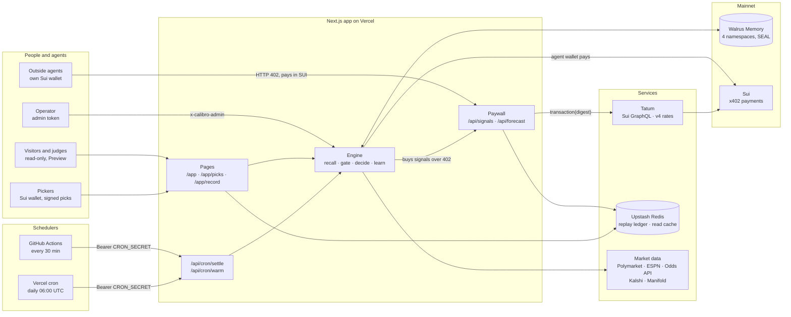
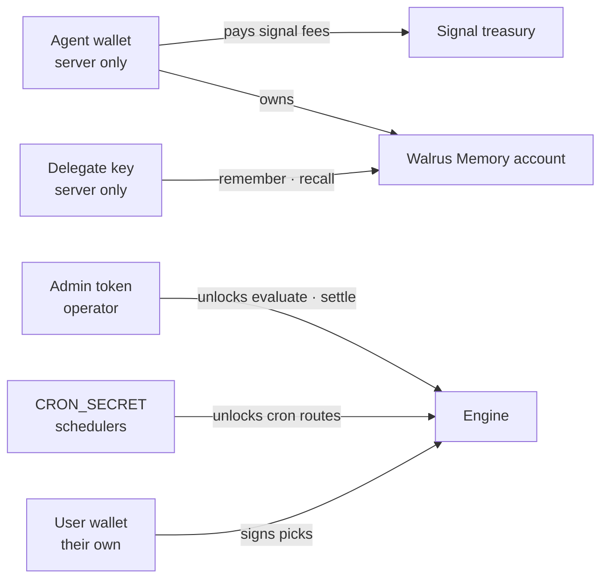
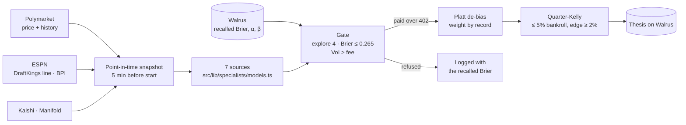
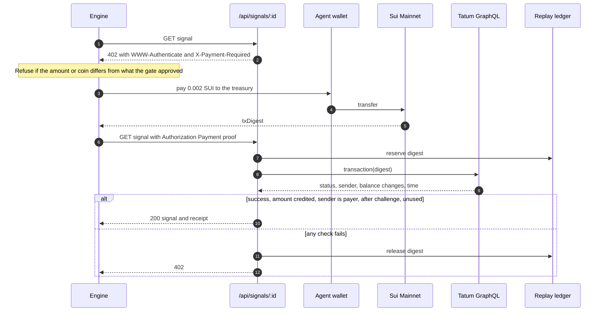
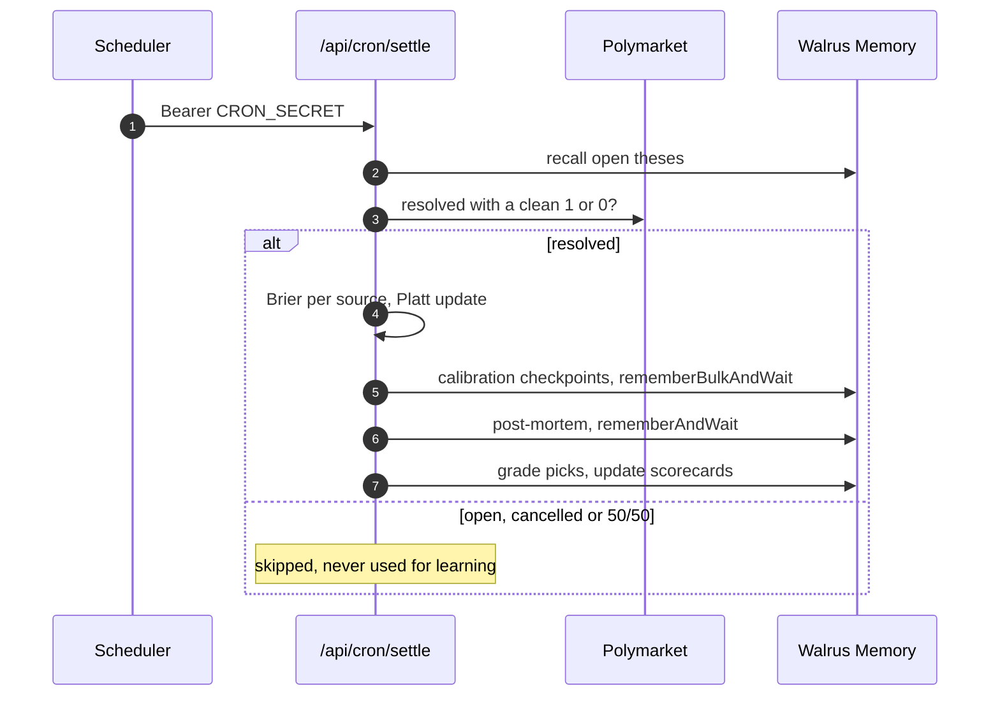
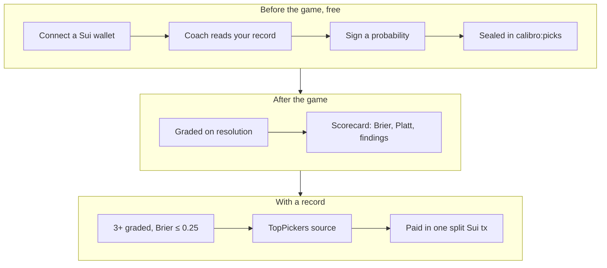

# Calibro

**A sports forecaster that remembers which sources were right, and pays only them.**

For every Polymarket game, Calibro recalls each source's track record from Walrus Memory, buys only the signals worth their fee over HTTP 402 with real Sui Mainnet payments checked through Tatum, and after the game writes the result back to Walrus. Everything is measured in one number: the **Brier score**, the mean squared error of a probability (0 is perfect, 0.25 is a coin flip, lower is better).

Built for Total Recall, the Tatum × Walrus Memory hackathon (Markets & Sports Prediction · Best Walrus Memory · Best Use of Agent Payments) · **Not affiliated with Polymarket, ESPN, Kalshi or Manifold** · App: [trycalibro.xyz](https://www.trycalibro.xyz) · Demo: [youtu.be/yo8e_a1CTP8](https://youtu.be/yo8e_a1CTP8) (2:58) · Write-up: [Medium](https://medium.com/@mrnetwork/teaching-a-prediction-agent-who-to-trust-walrus-memory-sui-x402-and-tatum-554f6735fece) · Code: [github.com/mrnetwork0001/Calibro](https://github.com/mrnetwork0001/Calibro)

**Judges, start here:** [trycalibro.xyz/app/record](https://www.trycalibro.xyz/app/record) lists every settled game straight from Walrus, with each Sui payment and each Walrus blob linked. Then open [/app](https://www.trycalibro.xyz/app), pick a resolved game and press **Preview** to run the real engine on the real recalled record, with nothing paid or written. No wallet or login needed for either.

---

## Five steps, no wallet needed

| Step | What it is | Try it without a wallet |
| --- | --- | --- |
| **Recall** | Before each game Calibro reads its memory from Walrus: the risk mandate, the newest Brier score and Platt parameters for every (source, league) pair, and similar past games. The memory is SEAL-encrypted and lives on Walrus Mainnet, not in a database. | `/app` → the calibration panel and the **memory inventory** drawer, which walks every namespace live. |
| **Refuse** | Each source is bought for its first 4 settled games in a league. After that, a source whose recalled Brier is above 0.265 is refused, and so is one whose value of information doesn't cover its fee. *HypeContrarian scored 0.322, worse than a coin flip, so Calibro paid it 12 times and refused it 29.* | `/app/record`: the refused sources and the reason, game by game. |
| **Pay** | Every signal answers `402 Payment Required`. Calibro pays 0.002 SUI on Sui Mainnet, and the server checks the transaction through Tatum's Sui GraphQL gateway before it releases the signal. | `curl -i "https://www.trycalibro.xyz/api/signals/sharp-steam?marketId=poly-nba-6428614"` returns the real 402 challenge. |
| **Decide** | Paid signals are de-biased (Platt scaling), weighted by their record, and turned into a paper stake with quarter-Kelly. Deterministic TypeScript: no language model picks a number. | `/app` → a resolved game → **Preview**. |
| **Learn** | When Polymarket resolves the game, a scheduled job scores every signal it bought and writes the post-mortem and new calibration checkpoints back to Walrus. Nobody presses a button. | `/app/record` → any game → its post-mortem blob on Walruscan. |

### More to explore

| Feature | What it is | Where |
| --- | --- | --- |
| **Pick journal** | Connect any Sui wallet, sign a probability before the game, and the pick is sealed in `calibro:picks` on Walrus. The server verifies the signature (zkLogin included) through Tatum. When the game resolves, it is graded with the same Brier and Platt maths the sources get. | `/app/picks` (wallet needed to pick, not to read) |
| **Pick coach** | Before you sign, Calibro recalls your graded picks and its own record and tells you what they say about your number, as a shrunk estimate you can adopt with one click. Each pick records whether advice was shown, so the coach itself gets graded. | `/app/picks` |
| **TopPickers** | Users with 3 or more graded picks and a Brier of 0.25 or better become a paid source. One Sui transaction splits the fee between their wallets, and the server checks through Tatum that each share arrived. It has already happened twice on Mainnet. | `/app/picks` leaderboard |
| **Calibro sells its forecast** | Any agent can buy Calibro's calibrated probability, with the sources it paid and refused and the Walrus blob of the thesis, for 0.01 SUI over the same 402 protocol. | `GET /api/forecast?marketId=…`, catalog at [`/.well-known/x402`](https://www.trycalibro.xyz/.well-known/x402), [`/llms.txt`](https://www.trycalibro.xyz/llms.txt) |
| **Learning timeline** | A slider over every settled post-mortem. Each step is one settlement: weights shift, refusals switch on, and each step links to its blob. It replays the engine's own update function, and a test checks it reproduces the stored checkpoints exactly. | `/app` → Learning timeline |
| **Disagreement alerts** | Games where the sportsbook or Kalshi is 3 or more points from Polymarket, or where the sources split on the favourite, are flagged. | `/app` |
| **Portable brain** | A fresh process with no database and no `.env`, given only three environment variables, recalls the same record and makes the same call. | `npm run agent:portable` |

The terminal (`/app`) pairs the markets with the forecast for the selected game, the payment tape (every 402, payment and Tatum verification as it happens), the calibration panel and the learning timeline. A status ribbon shows Tatum's latest checkpoint, the SUI price and the memory count, and opens the memory inventory drawer. It folds into drawers on phones. Live evaluation of upcoming games spends real SUI, so it sits behind an **Operator** link and an admin token. Everyone else gets Preview.

## Why Walrus Memory is essential

Without the memory there is no record, and without the record Calibro would pay every source every time.

- **No memory, no refusal.** The payment gate in `src/lib/calibration/brier.ts` decides from the Brier score recalled from `calibro:calibration`. A fresh agent has nothing to refuse with.
- **No memory, no learning.** Each settlement recalls the sealed pre-game thesis from `calibro:episodic`, scores it, and writes the new checkpoint back (`src/lib/orchestrator/syndicate-engine.ts`). The next game starts from that checkpoint.
- **The memory is the agent.** `scripts/portable-agent-demo.ts` runs with only `MEMWAL_ACCOUNT_ID`, `MEMWAL_PRIVATE_KEY` and `TATUM_API_KEY`, loads no `.env` and no database, and makes the same refusal as the live app.
- **Anyone can check it.** Every settled game's post-mortem is a Walrus blob linked from `/app/record`, so the record can't be edited after the fact.

## Architecture

Calibro has four layers:
- **The chains:** Sui Mainnet carries every payment; Walrus Memory Mainnet holds the record.
- **The app:** one Next.js 15 app on Vercel serves the pages, the paid signal endpoints and the forecast.
- **The services:** Tatum's Sui GraphQL gateway and v4 rates API, Upstash Redis for the replay ledger and read cache, and the market data providers.
- **The schedulers:** a GitHub Actions job every 30 minutes and a daily Vercel cron settle games and refresh the cache.

### System overview



**The engine buys from its own paywall.** Calibro's sources are served behind the same HTTP 402 endpoints an outside agent would use, so every signal it uses is a real payment with a real digest. The fees go to a treasury the team controls; the forecast fee goes to the agent wallet that pays for signals.

**State.** The record lives on Walrus, not in a database. Redis holds only two things: the replay ledger (digests already redeemed) and a read cache of Walrus-backed views, because recalling and decrypting a full record takes the relayer 15 to 25 seconds. When Walrus is slow, the last good value is served with its timestamp; when nothing is cached, the panel says what failed. Locally, files under `.calibro/` stand in for Redis.

### Who holds which key



| Key | Lives in | Can | Can never |
| --- | --- | --- | --- |
| Agent wallet (`CALIBRO_AGENT_SUI_PRIVATE_KEY`) | Production server env | Pay the amount a 402 challenge asks, when the gate approved it | Pay more than the gate approved, or in a different coin (`src/lib/x402/http-signal-provider.ts`) |
| Walrus delegate key (`MEMWAL_PRIVATE_KEY`) | Production server env | Write and recall memories in Calibro's account | Move funds or approve transactions (Walrus delegate keys can't) |
| Admin token (`CALIBRO_ADMIN_TOKEN`) | The operator's browser | Run a live evaluation (spends SUI) or a manual settle (writes Walrus) | Anything on its own; without it, production refuses both (`src/lib/server/runtime.ts`) |
| `CRON_SECRET` | Vercel and GitHub secrets | Call `/api/cron/settle` and `/api/cron/warm` | Evaluate, i.e. spend on new signals |
| User wallet | The user's own wallet | Sign a pick | Be charged: picks are free signatures, never transactions |

### From market data to a forecast



The seven sources are documented formulas or outside crowds:

| Source | What it is | Leagues |
| --- | --- | --- |
| SharpSteam | De-vigged sportsbook line plus half the open-to-close move | NBA, EPL, UFC |
| PowerRating | ESPN BPI win probability | NBA |
| OnchainFlow | Polymarket price plus half its last-6-hour move | all |
| HypeContrarian | Fades the crowd and the last day's move | all |
| KalshiCrowd | Kalshi exchange price | NBA, EPL, UFC |
| ManifoldCrowd | Manifold community forecast | NBA |
| TopPickers | Trust-weighted picks of qualified users; fee split to their wallets | NBA, EPL, UFC (upcoming) |

A source with no data for a game answers 404 before any challenge, so it is never paid for nothing.

### One paid signal, end to end



The `challengeId` is HMAC-signed and self-describing, so any serverless instance can verify the paid retry without a challenge database, and nobody can change the amount or recipient. The digest is reserved before the Tatum call, so two concurrent requests can't redeem it twice.

### Settlement: the scheduled loop



Settlement is idempotent: each checkpoint records the market that produced it, so re-running is a no-op and a crash between writes can't double-count.

### Pickers: from a signature to a payout



### A real game, end to end

**Lakers vs. Pistons, 8 to 9 November 2026.** Evaluated live before tip-off: six signals paid over 402, for example SharpSteam [`Fk7eWK…hA7D`](https://suiscan.xyz/mainnet/tx/Fk7eWKgJQvoQhtMnq5jCtnF6pwzEQdvYLxYKuvn9hA7D) and TopPickers [`M5FUA4…cFmi`](https://suiscan.xyz/mainnet/tx/M5FUA4aj5BjiUHjHt5uD3PKpFemxsHYNf8meio7cFmi), paid to a qualified picker's wallet. HypeContrarian was refused (recalled NBA Brier 0.310). Calibro said 35.0% Lakers, Polymarket 37.5%. Lakers won. Polymarket resolved it, and Vercel's daily cron settled it at 06:22 UTC on 9 November and wrote the post-mortem [`kAko0gTe…eJUQ`](https://walruscan.com/mainnet/blob/kAko0gTeutdFhq4gqh1d0PqHZFlgo7gPcBxaz24eJUQ). An outside wallet also bought Calibro's forecast for that game for 0.01 SUI: [`AM4Q96W3…CP3K`](https://suiscan.xyz/mainnet/tx/AM4Q96W3MDfj1PHwBHphemr1buaRstQG8Z6XVfJhCP3K).

## Results so far

From [`/api/record`](https://www.trycalibro.xyz/api/record) and [`/api/status`](https://www.trycalibro.xyz/api/status), read 9 November 2026 at 08:45 UTC:

| | |
| --- | --- |
| Games settled on Mainnet | 41 (27 NBA, 7 EPL, 7 UFC), played 31 October to 8 November 2026 |
| Mean Brier: Polymarket | 0.185 |
| Mean Brier: equal-weight average of the sources | 0.192 |
| Mean Brier: Calibro | 0.194 |
| Signals paid over 402 | 144, each with a Sui digest |
| Payments refused from memory | 29, all HypeContrarian (23 NBA, 3 EPL, 3 UFC) |
| Paper P&L on a $2,500 bankroll | −$394 |
| Memories on Walrus | 312: 82 episodic, 173 calibration, 56 picks, 1 mandate |

**Calibro has not beaten Polymarket, or a plain average of its sources.** What it shows is that it learns which sources are worth paying, from real outcomes, and stops paying the one that is worse than a coin flip. The paper P&L is reported as it is rather than tuned on the same games.

## Safety

- **What the agent wallet can do.** Pay a challenge only up to the amount and in the coin the gate approved; payments from one wallet are serialized so they don't contend for the gas coin (`src/lib/x402/http-signal-provider.ts`).
- **Hard limits.** Kelly multiplier ≤ 0.25, stake ≤ 5% of bankroll per market, minimum edge 2%, and a per-slate SUI budget (`src/lib/calibration/brier.ts`). Stakes are paper; Calibro never places a bet.
- **Receipt checks.** Status success, recipient (and every split share) credited at least the amount in the challenge's coin, sender is the payer, landed after the challenge was issued, digest never redeemed. A malformed digest is a 402, not a 502 (`src/lib/x402/paywall.ts`, `src/lib/tatum/sui-rpc.ts`).
- **Replay protection.** Redeemed digests are kept in Redis in production, and signal sales are refused on Vercel without it (`src/lib/x402/replay-ledger.ts`).
- **Writes are guarded.** Evaluate and settle need `x-calibro-admin` and are refused in production without `CALIBRO_ADMIN_TOKEN`. Cron routes need `CRON_SECRET`. The public preview is rate-limited (`src/lib/server/rate-limit.ts`).
- **Fail closed.** No sandbox and no fixtures: without Walrus keys the app reports UNCONFIGURED and is read-only; without a SUI/USD rate from Tatum it doesn't price fees.
- **Tests.** 90 tests in 11 files, all passing on 9 November 2026 (see *Run it locally*).

## What's real and what's not

| Real | Not real, and labelled |
| --- | --- |
| Polymarket markets, prices and resolutions; DraftKings lines via ESPN; ESPN BPI; Kalshi and Manifold prices | **Replayed games:** most of the 41 settled games were trained by replaying finished games at their prices 5 minutes before the start. Their payments and Walrus writes are real. |
| Every Sui payment, verified through Tatum, with its digest on Suiscan | **The signal treasury is ours.** No outside vendor sells signals over 402 on Sui yet, so Calibro's own models are the vendors. |
| Every thesis, post-mortem, checkpoint and pick on Walrus Memory Mainnet | **Stakes are paper.** Calibro recommends a leg and a quarter-Kelly stake; it doesn't bet. |
| TopPickers payouts to a real picker's wallet | **Preview** runs the engine with signals computed in-process: nothing paid, nothing written, and it says so on screen. |
| | `MemWalMock` appears only in tests, the cold-start comparison, the visitor preview's empty-memory column and `npm run train:preview`, each labelled. |

## Tech stack

Next.js 15 (App Router) · React 19 · TypeScript 5.8 · Tailwind CSS 4 · `@mysten-incubation/memwal` 0.1.13 (relayer `relayer.memory.walrus.xyz`, SEAL via `@mysten/seal` 1.5) · `@mysten/sui` 2.39 (`SuiGraphQLClient`, `Transaction`, `verifyPersonalMessageSignature`) · `@mysten/wallet-standard` · Tatum Sui Mainnet GraphQL gateway and v4 rates · Upstash Redis · Vitest 3 · Vercel, GitHub Actions.

## Run it locally

**Prerequisites:** Node 20+, a Tatum API key, and for live mode a Walrus Memory account and a Sui wallet holding a little SUI.

| Variable | What it does |
| --- | --- |
| `MEMWAL_PRIVATE_KEY`, `MEMWAL_ACCOUNT_ID` | Walrus Memory delegate key and account. Unset: the app is read-only. Create with `npm run memwal:provision`. |
| `MEMWAL_SERVER_URL` | Relayer, default `https://relayer.memory.walrus.xyz`. |
| `TATUM_API_KEY` | Tatum Sui GraphQL and v4 rates. Required: receipts can't be verified without it. |
| `TATUM_SUI_MAINNET_GRAPHQL` | Default `https://sui-mainnet.gateway.tatum.io/graphql` (the JSON-RPC root returns 404). |
| `CALIBRO_AGENT_SUI_PRIVATE_KEY` | The wallet that pays for signals. Use a fresh wallet with a few SUI. |
| `CALIBRO_SIGNAL_TREASURY_ADDRESS` | Where signal fees go. |
| `CALIBRO_X402_DEFAULT_PRICE_RAW` | Signal price in MIST, default `2000000` (0.002 SUI). |
| `CALIBRO_X402_CHALLENGE_SECRET` | Signs 402 challenges. Blank: derived from the Walrus key so every instance agrees. |
| `CALIBRO_ADMIN_TOKEN` | Required header for evaluate and settle. Unset in production: both are refused. |
| `CRON_SECRET` | Bearer token for the cron routes. |
| `UPSTASH_REDIS_REST_URL`, `UPSTASH_REDIS_REST_TOKEN` | Replay ledger and read cache. Required on Vercel; locally, files under `.calibro/`. |
| `THE_ODDS_API_KEY` | Optional: Pinnacle lines for upcoming games. Past games use DraftKings via ESPN. |

```bash
npm install
npm run setup:keys        # writes .env.local: agent wallet, treasury, server secrets
npm run memwal:provision  # Walrus Memory account and delegate key
npm run verify            # preflight: keys, wallet balance, data sources
npm run train:preview     # real-data backtest, nothing paid or written
npm run dev               # http://localhost:3000
```

Other scripts:

| Command | What it does |
| --- | --- |
| `npm run train -- --server http://localhost:3000 --yes` | Trains on real resolved games: buys every signal over 402, writes everything to Walrus, updates `docs/mainnet-memory-proof.json`. Resumable. |
| `npm run settle` | Settles resolved games and grades picks (`-- --every 30` keeps running). |
| `npm run agent:portable` | The portable-brain demo: recall and decide with no database. Read-only. |
| `npm run buy:forecast` | An outside agent buying Calibro's forecast over 402 (`BUYER_SUI_PRIVATE_KEY`). |

```bash
npm run typecheck && npm test && npm run build
```

> **Test status, 9 November 2026:** `Test Files  11 passed (11)` · `Tests  90 passed (90)`

GitHub Actions runs typecheck, tests and build on every push ([`ci.yml`](.github/workflows/ci.yml)).

## Deploying

1. **Vercel:** import the repo and set the variables above. `CALIBRO_ADMIN_TOKEN`, `CRON_SECRET` and Upstash Redis (or Vercel KV) are required in production.
2. **Schedulers:** Vercel's Hobby plan runs crons once a day, so [`vercel.json`](vercel.json) settles daily at 06:00 UTC, and [`settle.yml`](.github/workflows/settle.yml) calls `/api/cron/settle` and `/api/cron/warm` every 30 minutes. Add repository secrets `CALIBRO_URL` and `CRON_SECRET`. Both routes are idempotent.
3. **Function time:** evaluate, settle, forecast, preview and the cron routes are allowed Vercel's 300-second limit, because a full recall and a slate of payments take minutes.
4. **Fund the agent wallet** with a little SUI (each signal is 0.002 SUI plus gas).
5. **Live:** [www.trycalibro.xyz](https://www.trycalibro.xyz), on Sui and Walrus Mainnet:
   - Walrus Memory account [`0x47a5…c0ec`](https://suiscan.xyz/mainnet/object/0x47a5e5519693665084fd119d8f0c8802c7a331d8d80b71298183e80af833c0ec)
   - agent wallet [`0xe33f…7c82`](https://suiscan.xyz/mainnet/account/0xe33f666912d7e58ea5f86b25c37059b8c47e4dcfb83deadce4603c37e1267c82)
   - signal treasury [`0x5e2d…a450`](https://suiscan.xyz/mainnet/account/0x5e2d891a6c7da182d4618d383d2221b20ba171c1dcdfa836d207af8ceff3a450)

## Known limits

- **Recall scale.** The relayer returns at most 100 hits, and `sort: "recent"` re-sorts a semantic window rather than listing the namespace. Calibro recalls each (source, league) pair separately and replays settled post-mortems per league, which is exact up to roughly 50 settlements per league. Beyond that, a compaction snapshot is needed.
- **No way back after a refusal.** An unpaid signal can't be scored, so a refused source can't earn its way back yet.
- **Tatum free plan.** 3 requests a second; the client throttles and retries on 429.
- **ESPN's endpoints are public but unofficial.**

## Repository map

```text
src/
  app/
    page.tsx                     landing page
    app/page.tsx                 terminal: markets, forecast, payment tape, calibration
    app/picks/page.tsx           pick journal, coach, leaderboard
    app/record/page.tsx          every settled game from Walrus
    api/                         markets, status, calibration, timeline, record, leaderboard,
                                 walrus/audit, signals/[specialistId], forecast, picks, picks/coach,
                                 evaluate, evaluate/preview, settle, cron/settle, cron/warm
    .well-known/x402/route.ts    payment catalog for agents
  lib/
    calibration/brier.ts         Brier, Platt, payment gate, trust weights, Kelly
    orchestrator/                recall → gate → decide → learn
    walrus/memory-client.ts      4-namespace Walrus Memory client
    tatum/sui-rpc.ts             Tatum Sui GraphQL (receipts, balances, checkpoints) and v4 rates
    x402/                        402 protocol, paywall, signal gate, buyer, Sui payer, replay ledger
    specialists/models.ts        the seven sources
    picks/                       signed picks, scorecards, coach, TopPickers
    forecast/                    the forecast product
    markets/ · data/             point-in-time snapshots, settlement; Polymarket, ESPN, Odds API, Kalshi, Manifold
    timeline/                    learning-timeline replay
    server/                      runtime gates, read cache, read models, rate limits
  components/                    terminal, picks, record, landing, brand
scripts/                         setup-keys, provision, verify, train-mainnet, settle, portable agent, buy-forecast
tests/                           11 Vitest files
docs/                            blog post, submission checklist, mainnet proof (training run, 7 Nov)
.github/workflows/               ci.yml, settle.yml
```

## Pre-existing work and credits

- **Data:** Polymarket Gamma and CLOB APIs, ESPN public endpoints (DraftKings lines, BPI), The Odds API, Kalshi and Manifold public APIs.
- **Infrastructure:** Walrus Memory (`@mysten-incubation/memwal`), Sui (`@mysten/sui`, `@mysten/seal`, `@mysten/wallet-standard`), Tatum's gateway and rates API, Upstash, Vercel.
- **Code:** written for this hackathon; the git history starts on 7 November 2026. No vendored code.
- **Demo film:** narration, music and effects by ElevenLabs; rendered with Remotion.

## License

Apache-2.0. See [LICENSE](LICENSE).

---

*Calibro is a hackathon project. Its stakes are paper, its forecasts are not financial advice, and it is not affiliated with Polymarket, ESPN, Kalshi, Manifold, Tatum or Walrus.*
